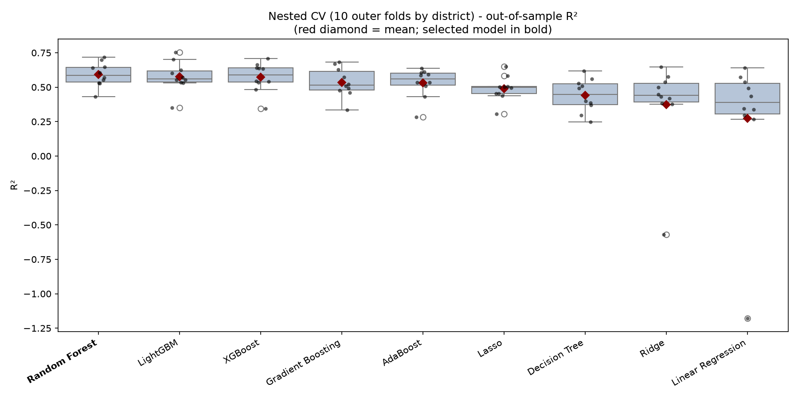
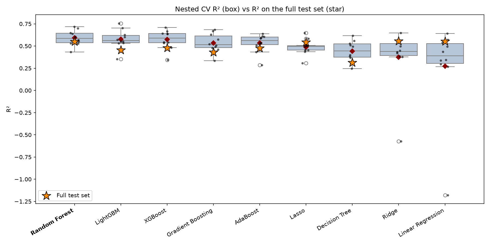
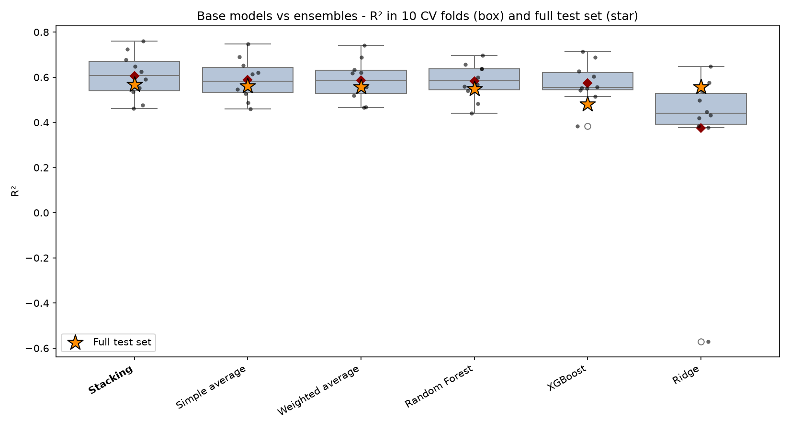
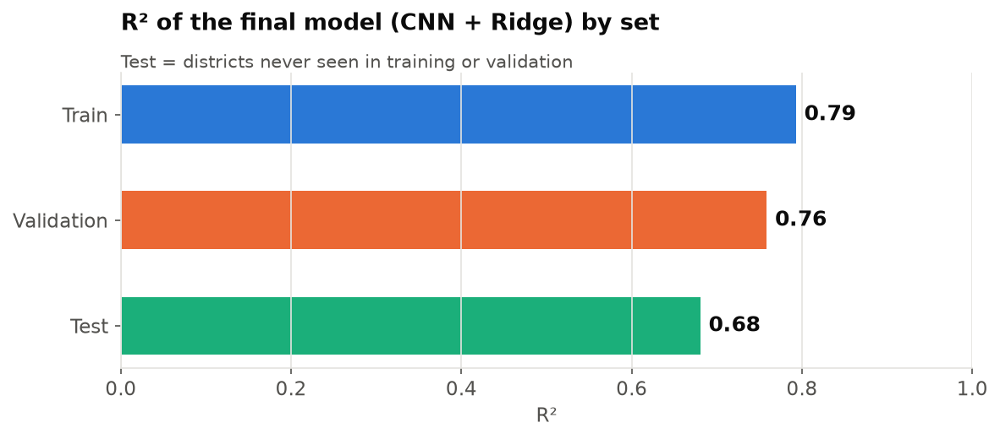
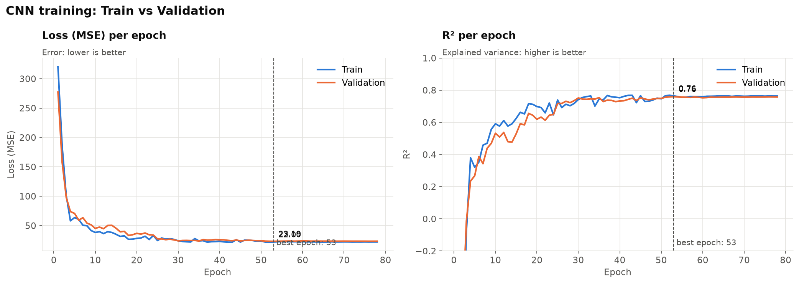
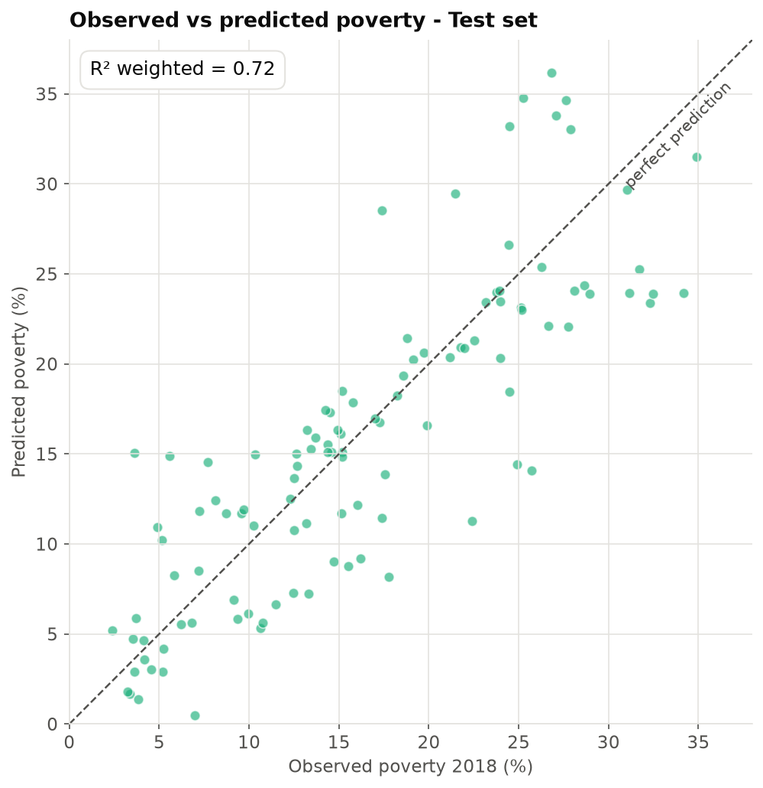
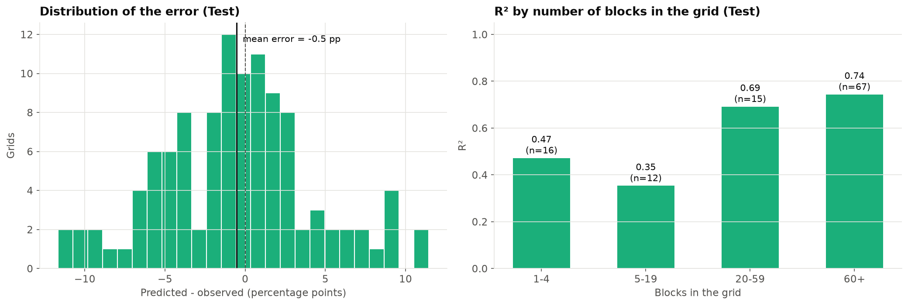

# Poverty Prediction in Peru: Block-Level Urban Poverty with Machine Learning

This project predicts the **poverty rate (%) of urban city blocks (*manzanas*) in Peru** with machine learning.
It combines 2017 census data, satellite (remote sensing) data and district-level administrative data.

It has two parts:

1. **Classical machine learning at block level**: 9 models compared with nested cross-validation, plus
   ensembles (averages and stacking).
2. **Deep learning on satellite imagery**: a convolutional neural network (CNN) that combines Landsat 8
   images with socioeconomic variables to predict poverty on 2 km grids.

### Methods at a glance

| Area | Techniques used |
|---|---|
| Data engineering | Google Earth Engine extraction (Landsat 8, VIIRS, SRTM, WorldClim), spatial joins and grid aggregation with GeoPandas, raster cropping and georeferencing with Rasterio |
| Data cleaning | Outlier detection (IQR, DBSCAN, Local Outlier Factor, Isolation Forest) and imputation (mean, KNN, MissForest) |
| Classical ML | Linear models, decision trees, Random Forest, Gradient Boosting, XGBoost, LightGBM, AdaBoost; nested cross-validation; ensembles and stacking |
| Deep learning | Two-input CNN (image + tabular vector) in TensorFlow/Keras: residual blocks, BatchNorm, SpatialDropout, wide path, data augmentation (rotations and flips), learning-rate scheduling and early stopping |
| Validation | Train / validation / test splits **by district** to avoid spatial leakage; architecture selected by cross-validation by district, never with the test set |

## Motivation

Peru's national statistics institute (INEI) published the 2018 poverty map disaggregated to the
**block level only for some large urban cities**. Most urban areas of the country have no block-level
poverty estimate at all. Only 73 of the 1,104 districts with urban blocks have it.

This project trains machine learning models on the blocks that do have a poverty rate. It then uses
the best model to **predict the poverty rate of the urban blocks that don't**.

| | Blocks | Districts |
|---|---:|---:|
| Urban blocks with 2018 poverty rate (training + test) | 115,948 | 73 |
| Urban blocks without poverty rate (prediction) | 83,967 | 1,032 |

## Predictors

| Group | Level | Variables | Source |
|---|---|---|---|
| **Census 2017** | Block | Population share by age group (15-29, 30-44, 45-64); share with higher education; share without health insurance; share whose native language is not Spanish; employment rate; share of white-collar workers; share of workers by economic sector (extractive, manufacturing & construction, services) | INEI, *Censo de Población y Vivienda 2017* |
| **Remote sensing** | Block | Night-light density (VIIRS DNB monthly, 2017 average); elevation (SRTM 90 m); annual mean temperature (WorldClim bio01) | Google Earth Engine |
| **Location** | Block | Latitude and longitude of the block centroid | Block shapefile 2017 |
| **District poverty** | District | Poverty rate 2013 | INEI |
| **Social program** | District | Dummy = 1 if the district received the *Juntos* conditional cash transfer program | MINEDU school census |
| **Municipal finances** | District | Municipal revenue and spending (infrastructure, health, education, etc.) in millions of soles per 1,000 inhabitants | INEI, RENAMU 2016 |

**Target:** `Pobreza2018`, the poverty rate (%) of the block, from INEI's *Mapa de Pobreza 2018*
(urban disaggregation).

## Pipeline

```
Procesing_data_GoogleEarth.ipynb   ->  night lights, elevation and temperature per block (Google Earth Engine)
Feature_Engineering.ipynb          ->  census shares, merges, outlier detection and imputation -> DataForML.dta
TrainingModel.ipynb                ->  nested CV, model selection, ensembles, test evaluation, predictions

# Deep learning part
ShapefileManzana.ipynb             ->  2 km x 2 km grid over the urban blocks
Landsat_download.ipynb             ->  one satellite image per grid (Google Earth Engine; now set to Sentinel-2 RGB,
                                       the results below use Landsat 8)
CNNModel.ipynb                     ->  image preprocessing, CNN training, evaluation, predictions per grid
```

### 1. Feature engineering, outlier detection and imputation

For each block-level variable (census shares and night lights), the notebook tries several
**outlier-detection** methods. It sets the detected outliers to missing:

- **Interquartile range (IQR)**: values outside `[Q1 - 1.5·IQR, Q3 + 1.5·IQR]`.
- **DBSCAN**: density-based clustering; points outside any cluster are outliers.
- **Local Outlier Factor (LOF)**: points with much lower local density than their neighbors.
- **Isolation Forest**: points that are isolated with few random splits.

It fills the resulting missing values with three **imputation** methods:

- **Mean** imputation.
- **KNN imputer** (10 neighbors, on min-max scaled data).
- **MissForest** (iterative imputation with random forests).

This gives 4 × 3 = 12 candidate versions of each variable. The notebook keeps the version whose distribution
is **closest to the original**. It first prefers versions where the Kolmogorov-Smirnov test does not reject
equal distributions, then the smallest change in skewness, then the smallest change in kurtosis.
DBSCAN and LOF run on 10 random blocks of the data in parallel to handle the roughly 200,000 blocks.

### 2. Train-test split by district

The data is split **80% train / 20% test by district (UBIGEO)**, not by block. All blocks of a district
fall in the same set. This reduces the spatial correlation between the two sets, so the test measures how
well the model predicts **new districts**, which is the real use case.

- Train: 92,387 blocks in 58 districts.
- Test: 23,561 blocks in 15 districts. They are never used for training or hyperparameter tuning.

### 3. Model comparison with nested cross-validation

Nine models are compared, each inside a pipeline with median imputation. Linear models also get
standardization.

- **Linear:** Linear Regression, Lasso, Ridge.
- **Tree-based:** Decision Tree, Random Forest, Gradient Boosting (histogram-based), XGBoost, LightGBM, AdaBoost.

**Nested cross-validation** runs on the training set, with folds also built by district:

- **Outer loop (10 folds):** gives 10 out-of-sample R² values per model.
- **Inner loop (3 folds):** `RandomizedSearchCV` (20 combinations) tunes the hyperparameters inside each outer training fold.

The selected base model follows the **one-standard-error rule**. Among the models whose mean R² is within
one standard error of the best model, the one with the lowest R² standard deviation is chosen.

### 4. Ensembles

The best models with different learning biases (Random Forest, XGBoost and Ridge) are combined in three ways:

- **Simple average** of the three predictions.
- **Weighted average**: non-negative weights that sum to 1 and minimize the MSE of the out-of-fold predictions.
- **Stacking**: a linear meta-model with non-negative coefficients, fitted on out-of-fold predictions
  (5 folds by district).

The final model is the one with the highest mean R² in cross-validation on the training set. It is chosen
**without looking at the test set**, and then evaluated on the **full test set**.

## Results

### Nested cross-validation: all models (10 outer folds, out-of-sample)

| Model | R² mean | R² std | R² min | R² max | RMSE mean | Within 1-SE of best |
|---|---:|---:|---:|---:|---:|:---:|
| **Random Forest** | **0.592** | 0.087 | 0.433 | 0.717 | 5.62 | ✔ |
| LightGBM | 0.578 | 0.109 | 0.352 | 0.755 | 5.71 | ✔ |
| XGBoost | 0.573 | 0.107 | 0.345 | 0.707 | 5.73 | ✔ |
| Gradient Boosting | 0.535 | 0.106 | 0.336 | 0.683 | 5.99 | |
| AdaBoost | 0.533 | 0.106 | 0.285 | 0.638 | 6.00 | |
| Lasso | 0.489 | 0.090 | 0.307 | 0.649 | 6.27 | |
| Decision Tree | 0.441 | 0.120 | 0.247 | 0.618 | 6.55 | |
| Ridge | 0.375 | 0.344 | −0.571 | 0.648 | 6.70 | |
| Linear Regression | 0.274 | 0.526 | −1.179 | 0.640 | 7.08 | |

**Random Forest** has the highest mean R² and is also the most stable of the three candidates, so it is the
selected base model. Tree-based ensembles clearly beat the linear models. The linear models also have a very
unstable R² across districts.



*Each point is one outer fold (a set of held-out districts). Red diamond = mean.*

The test-set performance of each base model is shown below. Each model uses its final hyperparameters,
tuned on the full training set.

| Model | CV R² mean | Test R² | Test RMSE | Test MAE |
|---|---:|---:|---:|---:|
| **Random Forest** | 0.592 | **0.549** | 6.09 | 4.68 |
| LightGBM | 0.578 | 0.456 | 6.69 | 5.00 |
| XGBoost | 0.573 | 0.480 | 6.54 | 4.95 |
| Gradient Boosting | 0.535 | 0.430 | 6.84 | 5.09 |
| AdaBoost | 0.533 | 0.477 | 6.56 | 4.98 |
| Lasso | 0.489 | 0.545 | 6.12 | 4.84 |
| Decision Tree | 0.441 | 0.312 | 7.52 | 5.63 |
| Ridge | 0.375 | 0.556 | 6.04 | 4.79 |
| Linear Regression | 0.274 | 0.552 | 6.07 | 4.82 |



The linear models score well on this particular test set, but the nested CV shows they are unreliable across
districts. In some folds their R² is strongly negative. The test set has only 15 districts, so a single
test-set number is a noisier guide than the 10 outer folds.

### Ensembles

The table shows 10-fold CV on train (same folds as the nested CV) and the full test set. Rows are sorted by
CV R², with the best model first.

| Model | Type | CV R² mean | CV R² std | CV RMSE | Test R² | Test RMSE | Test MAE |
|---|---|---:|---:|---:|---:|---:|---:|
| **Stacking** | Ensemble | **0.605** | 0.100 | 5.50 | **0.567** | **5.96** | **4.50** |
| Simple average | Ensemble | 0.590 | 0.091 | 5.61 | 0.562 | 6.00 | 4.56 |
| Weighted average | Ensemble | 0.586 | 0.090 | 5.65 | 0.556 | 6.04 | 4.60 |
| Random Forest | Base | 0.582 | 0.080 | 5.70 | 0.549 | 6.09 | 4.68 |
| XGBoost | Base | 0.573 | 0.094 | 5.76 | 0.480 | 6.54 | 4.95 |
| Ridge | Base | 0.375 | 0.344 | 6.70 | 0.556 | 6.04 | 4.79 |



*Box = 10 CV folds on train; orange star = R² on the full test set.*

### Final model: Stacking

**Stacking** is the best model both in cross-validation and on the unseen test set:

| Metric (full test set, 15 unseen districts) | Value |
|---|---:|
| R² | **0.567** |
| RMSE (percentage points) | 5.96 |
| MAE (percentage points) | 4.50 |

The meta-model fitted on the full training set is:

```
Poverty = −3.14 + 1.038 · RandomForest + 0.124 · Ridge + 0.049 · XGBoost
```

Random Forest dominates. Ridge and XGBoost add small corrections.

## Predictions for blocks without data

Stacking is refitted on all 115,948 labeled blocks with fixed hyperparameters. It then predicts the poverty
rate of the 83,967 urban blocks without data. The output is
`output/ModelNestedCV/Ensembles/predictions_Stacking.csv` with these columns:

| Column | Description |
|---|---|
| `IDMANZANA` | Block identifier |
| `UBIGEO` | District code |
| `Pobreza2018_pred` | Predicted poverty rate (%) |
| `dpredict` | Always 1: the value is a model prediction |

The poverty rate is a percentage, so **predictions below 0 or above 100 are set to missing**.
This affects 15,021 blocks (17.9%). Most of them come from the Ridge component, which extrapolates badly for
blocks whose features fall far outside the training range.

## Deep learning: CNN on satellite imagery

The second part asks whether **satellite images** add information to the socioeconomic variables. It
trains a convolutional neural network that looks at a Landsat 8 image of each area and, at the same time,
reads a vector of socioeconomic variables.

### Unit of analysis: 2 km grids

Blocks are too small for a 30 m satellite image (a block is a few pixels), so the CNN works on a
**2 km × 2 km grid** over the urban areas.

- Each block is assigned to the grid that contains its centroid. Variables are averaged per grid.
  The district of the grid (`UBIGEO`) is the most frequent one among its blocks.
- Grids with the 2018 poverty rate: **946** (944 with an image), in 121 districts. They are used to train,
  validate and test the model.
- Grids without poverty rate: **3,350**. They are predicted at the end.

### Inputs

| Input | Content | Preprocessing |
|---|---|---|
| **Image** | Landsat 8 Collection 2, surface reflectance, 7 bands (coastal, blue, green, red, NIR, SWIR1, SWIR2), cloud-masked median of March–July 2018, 30 m | Centered crop to **68 × 68 pixels** (2.04 km), pixels outside the grid set to 0, each band scaled to [0, 1] with the min/max of train |
| **Socioeconomic vector** (32 variables) | Census shares, night lights, elevation, temperature, poverty 2013, *Juntos*, grid centroid; plus the **average of the neighboring grids within 5 km** (spatial context) | Clipped to the train range, median imputation, standardization (all fitted on train only) |

The 12 municipal-finance variables are **excluded**. In small districts without poverty data they take
extreme per-capita values, and the network then predicted rates above 100% in 808 of 3,350 grids. Without
them the validation R² is the same.

### Train / validation / test split by district

The split is **80% / 10% / 10% by district**. All grids of a district fall in the same set, so the validation
and test sets measure performance on **districts the model has never seen**. Neighboring grids are very
similar, so a random split by grid would give misleadingly high scores.

| Set | Grids | Districts |
|---|---:|---:|
| Train | 731 | 96 |
| Validation | 103 | 12 |
| Test | 110 | 13 |

**Data augmentation** (train only): each image is randomly rotated (0°, 90°, 180°, 270°) and flipped in
every epoch. These transformations are exact (no interpolation) and multiply the effective number of
training images by 8.

### Architecture

```
Image 68×68×7 ──► Conv 3×3 (32) ─► SpatialDropout
                 ─► Residual block (32)  + MaxPool  68 → 34
                 ─► Residual block (64)  + MaxPool  34 → 17
                 ─► Residual block (128) + MaxPool  17 → 8
                 ─► GlobalAveragePooling (128 values) ─┐
                                                       ├─► Dense(32) ─► Dropout ─► Dense(16) ─┐
Socioeconomic vector (32) ─────────────────────────────┤                                      ├─► Dense(1)
                                                       └──────────── wide path ───────────────┘
```

- **Residual blocks**: two 3×3 convolutions with batch normalization plus a shortcut that adds the block
  input to its output. Each block only learns the change over its input, which trains better with few images.
- **Regularization**: SpatialDropout 0.1 after each convolutional stage (switches off whole feature maps),
  Dropout 0.3 in the dense part, L2 penalty 1e-4.
- **Wide path**: the socioeconomic vector also goes straight to the output, so the network keeps a direct
  linear relation with the variables.
- **Output**: one neuron with linear activation (regression of the poverty rate in %).
- **Training**: Adam, MSE loss, R² / RMSE / MAE metrics, learning rate halved after 5 epochs without
  improvement, early stopping after 25 epochs (best weights restored).

**Final prediction = 0.5 × CNN + 0.5 × Ridge.** Ridge is a separate linear regression on the same
socioeconomic vector (no image), trained on train only. It is stable and captures the linear part; the CNN
adds what it sees in the image. Averaging both reduces the error of each one.

### How the architecture was chosen

Eight designs were compared with **5-fold cross-validation by district** on train + validation. The test set
was not used. Mean R² on the held-out districts:

| Design | CNN alone | Average CNN + Ridge |
|---|---:|---:|
| **Residual 32-64-128, dropout 0.1 / 0.3 (final)** | **0.57** | **0.64** |
| Same network, dropout 0.2 / 0.5 | 0.44 | 0.60 |
| Plain CNN 16-32-64 | 0.57 | 0.63 |
| CNN trained on the Ridge residual | 0.63 | 0.64 |
| Small, deep (4 blocks) or 5×5-kernel residual networks | 0.43–0.45 | 0.59–0.60 |
| *Ridge alone (no image)* | | *0.63* |

With stronger dropout the CNN stopped learning (R² 0.44). Lighter dropout let it learn while keeping the
train-validation gap small.

### Results

| Set | R² | R² weighted by number of blocks | RMSE (pp) | MAE (pp) |
|---|---:|---:|---:|---:|
| Train | 0.793 | 0.833 | 4.40 | 3.21 |
| Validation | 0.758 | 0.887 | 4.83 | 3.30 |
| **Test** (13 unseen districts) | **0.680** | **0.722** | **4.80** | **3.69** |

The gap between train and validation is only **0.03**: the model **learns patterns instead of memorizing**
the training grids. The weighted R² gives more weight to grids with more blocks, whose observed poverty rate
is more reliable.



Train and validation are measured the same way at the end of each epoch (without dropout and without
augmentation), so the two curves are comparable. Both converge to an R² of about 0.76:







What each part contributes on the test set:

| Model | Test R² |
|---|---:|
| **Final (CNN + Ridge)** | **0.680** |
| Ridge alone (no image) | 0.673 |
| CNN alone (image + variables) | 0.648 |

These R² values are at the **2 km grid level**, so they are not directly comparable with the block-level R²
of the first part: a grid averages many blocks and its poverty rate is less noisy.

### Predictions for grids without data

The final model predicts the poverty rate of the 3,350 grids without data (mean 24.3%). Predictions below 0
are set to 0 (13 grids) and above 100 to 100 (none). Outputs:

- `output/CNN/predictions_grid2km_cnn.csv`: `ID`, `UBIGEO`, centroid, number of blocks, predicted rate.
- `output/CNN/predictions_grid2km_cnn.gpkg`: the same with the grid geometry, ready for a map.

### Limitations and next steps

- **Landsat resolution (30 m) is coarse for cities.** A house is smaller than a pixel, so roofs, street
  widths and building density are not visible. With the image alone, the best R² was 0.26 (pretrained
  ResNet50 features). `Landsat_download.ipynb` is now set to download **Sentinel-2 RGB at 10 m**
  (9 times more pixels per grid) for the next version of the model.
- **The target varies little within a district.** `Pobreza2018` has only 251 distinct values across 115,948
  blocks (about 3 per district): INEI estimates poverty for groups of blocks, not for each one. This limits
  what any model can explain inside a district.
- **The test set has only 13 districts.** Across cross-validation folds the R² varies by about ±0.14, so a
  single test number should be read with that margin.

## Repository structure

```
├── notebook/
│   ├── Procesing_data_GoogleEarth.ipynb   # Night lights, elevation, temperature per block (GEE)
│   ├── Night_light_quarters_VIRRS.ipynb   # Earlier night-light extraction (grids / districts)
│   ├── Feature_Engineering.ipynb          # Census features, merges, outliers, imputation
│   ├── TrainingModel.ipynb                # Nested CV, ensembles, evaluation, predictions
│   ├── ShapefileManzana.ipynb             # 2 km grid over the urban blocks
│   ├── Landsat_download.ipynb             # Satellite image per grid (GEE)
│   └── CNNModel.ipynb                     # CNN: preprocessing, training, evaluation, predictions
├── scr/
│   └── utils.py                           # Helper functions (GEE, outliers, imputation, training, ensembles, plots)
├── img/                                   # Figures used in this README
├── output/ModelNestedCV/                  # Classical ML results: tables, figures, Excel report
├── output/CNN/                            # CNN results: figures and predictions per grid
├── requirements.txt
└── LICENSE
```

## How to reproduce

```bash
python -m venv .venv
.venv\Scripts\activate          # Windows  (Linux/macOS: source .venv/bin/activate)
pip install -r requirements.txt
```

Then run the notebooks in the order of the pipeline above. The data files are **not included** in the
repository because of their size. The raw data comes from INEI (Census 2017, *Mapa de Pobreza 2018*,
poverty 2013, RENAMU 2016), MINEDU and Google Earth Engine, and is expected under `data/raw_data/`.

The remote-sensing notebooks need a Google Earth Engine account. Install the package with
`pip install earthengine-api`. Do **not** install the unrelated PyPI package called `ee`: it fails on Windows
with `No module named '_curses'`.

`TrainingModel.ipynb` saves checkpoints (`.joblib` / `.csv`) after each model and each fold. If a run is
interrupted, running the notebook again skips the finished steps.

## License

Apache License 2.0. See [LICENSE](LICENSE).
